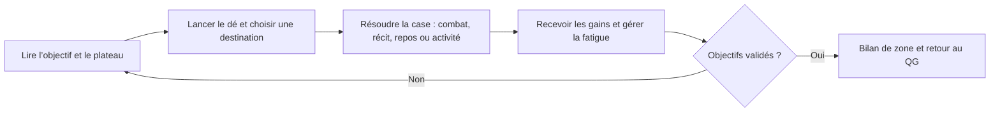
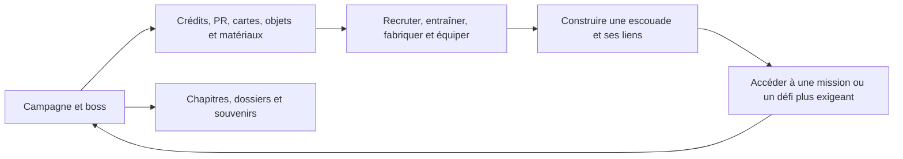

# Heroes Dawn — Revue du jeu après refonte de l’interface

5 novembre 2026. Revue du projet Unity local, des systèmes applicatifs, des parcours automatisés et des captures réelles. Les observations de conception sont des jugements de design ; elles ne remplacent ni un playtest externe ni une mesure de rétention.

## Avis général

Le meilleur axe du projet est le **RPG tactique d’escouade dans un New York reconstruit après la Supernova**. La campagne, les agents, les cartes de compétence et les liens d’équipe se renforcent mutuellement. Aube tactique donne à cet ensemble une identité plus cohérente et une meilleure hiérarchie.

Le risque principal est la dispersion : plateau, combat à chronologie, fabrication, recherche, opérations temporisées, collection, pass, objectifs quotidiens, tournoi, social et nombreux mini-jeux sollicitent le joueur. Le prochain gain de qualité viendra surtout de leur articulation et de leur profondeur, plutôt que d’un nouveau menu.

Je recommande de concentrer la prochaine version sur un parcours de campagne court, complet et très travaillé : préparer une équipe, choisir une mission, prendre des décisions sur le plateau, réussir un combat, comprendre sa récompense, modifier sa composition et repartir. Les systèmes secondaires doivent enrichir ce parcours ou pouvoir rester hors de sa première session.

## Boucle micro : ce que le joueur fait pendant une mission

Le dé définit les possibilités de déplacement ; le joueur doit ensuite choisir une destination utile. Le brouillard, les objectifs et les événements donnent une raison de lire le plateau. Le combat fait avancer les unités sur une chronologie, avec énergie, compétences, sélection et ciblage. Le présentateur gère également vitesse, automatique, pause et retraite. Une victoire verse des crédits, peut donner un objet, fournit des matériaux de fabrication et peut apprendre une recette. Elle développe les liens entre les agents engagés. La fatigue évolue après le combat ; une défaite avec escouade épuisée peut ramener au QG.

**Ce qui fonctionne :** la mission produit à la fois une décision immédiate et une conséquence pour l’équipe. Les boss à phases peuvent donner une vraie raison de préparer ses cartes et de cibler manuellement. Le bilan de combat est un point de liaison naturel entre action et progression.

**Ce qui reste à éprouver :** la valeur réelle des choix. Si l’automatique résout tout sans perte significative, la sélection de compétence devient cosmétique. Si le plateau impose surtout des lancers jusqu’à atteindre la bonne case, la mission ressemble à une attente. Le nombre de systèmes ne garantit pas le nombre de décisions intéressantes.

**À revoir :** rendre l’intention adverse, la cible, le coût et le prochain effet lisibles avant l’action. Comparer une partie manuelle et une partie automatique sur les mêmes rencontres. Une menace, une opportunité de combo ou une interruption doit pouvoir justifier la reprise du contrôle. Sur le plateau, chaque embranchement important devrait proposer un compromis compréhensible : risque, temps, récompense ou fatigue.

## Boucle macro : pourquoi le joueur repart en mission

La campagne alimente la progression de l’escouade. Les crédits, PR et gemmes ont des usages distincts ; les matériaux et recettes alimentent la fabrication. La collection de cartes, leurs améliorations, l’équipement et les liens apportent plusieurs leviers de préparation. Les chapitres, dossiers et souvenirs peuvent donner un objectif narratif à cette croissance. Les opérations temporisées occupent les agents hors escouade et rapportent des ressources. Les recherches modifient certains rendements ou coûts. Le pass et les missions quotidiennes récompensent l’activité.

**Point fort :** les agents peuvent porter l’attachement, le build, la narration et la collection. C’est le meilleur centre de gravité du jeu.

**Point faible :** les récompenses et les dépenses forment beaucoup de couches avant que leur valeur soit comprise. Le pass, la boutique et les temporisations risquent de prendre plus de place que l’envie de terminer la prochaine mission. L’existence de ces systèmes ne démontre pas encore un équilibre économique viable.

**Orientation proposée :** à chaque retour de mission, montrer d’abord ce qui a changé pour l’escouade et la prochaine opportunité. Ne pas obliger le joueur à visiter plusieurs écrans de récupération avant de rejouer. Les activités quotidiennes doivent accompagner la campagne, sans devenir un péage quotidien.

## Refonte des menus et des parcours

La première intégration portait principalement sur la charte et les composants. La seconde passe reprend les compositions et les limites des gabarits :

| Ensemble | Résultat de la passe | Point à surveiller |
|---|---|---|
| QG et navigation | Palette et panorama Aube tactique, fonctions illustrées, mission dominante, navigation persistante | Éviter la multiplication des alertes concurrentes |
| Boutique | Navigation latérale Héros / Boosters / Gemmes et crédits, cartes plus grandes, fiche de détail et action qui utilise la largeur disponible | Les offres et prix viennent du code, pas des nombres dessinés dans les maquettes |
| Cadeau quotidien | Accès explicite au Pass depuis la boutique ; un seul lieu de récupération | Le cadeau a été déplacé dans le Pass en 0.15 ; ne pas le dupliquer pour imiter une ancienne planche |
| Booster | Paquet The Dawn, cartes illustrées, révélation puis résumé distinct, retour au jeu | Le résumé ne tire aucune nouvelle carte et ne dépense aucun booster supplémentaire |
| Recrutement | Portraits agrandis, trois offres conservées, onglets latéraux, ressources et confirmation | La fiche d’agent porte les informations approfondies |
| Grimoire, inventaire, registre et équipement | Nombre de colonnes adapté, filtres répartis, détail défilant, actions visibles | Les listes longues doivent rester rapides à parcourir sur un petit écran |
| Atelier | Recettes accessibles dès l’entrée ; recherches dans un mode séparé | Distinguer clairement fabrication immédiate et recherche temporisée |
| Opérations, Pass, chapitres, repaire, tournoi et profil | Gabarit de liste repris : actions sous le texte dans les colonnes étroites, listes secondaires défilantes | Certains ensembles restent volontairement des listes ; le contenu ne justifie pas toujours un écran spectaculaire |
| Archives | Texte de détail défilant | Tester la longueur des récits et leur confort de lecture sur téléphone |
| Réglages | Huit catégories à gauche, illustration de Giulia, contrôles à droite ; page et lignes reproductibles par recettes | Vérifier le confort de lecture des aides et des listes sur téléphone |
| Compte, dialogues, confirmations et tutoriel | Charte commune et composition conservées dans le viewport sûr | Clavier logiciel et confort tactile à valider sur appareil |
| Combat, plateau et activités | Habillage conservé ; adaptation générale du canvas au format sûr | Les éléments de gameplay de certains mini-jeux restent visuellement ceux du prototype |
| Consignes des mini-jeux | Panneau opaque distinct du terrain et du manuel | Vérifier la compréhension sans explication orale |

Les planches restent des intentions. Les identités, valeurs, coûts, règles et textes du jeu priment sur les exemples générés. La refonte n’ajoute ni héros inventé ni produit payant fictif.

## Forces, faiblesses et décisions recommandées

| Système | Force | Faiblesse ou risque constaté dans sa structure | Décision de design proposée |
|---|---|---|---|
| Campagne et plateau | Cadre commun pour exploration, récit et combat | Répétition possible des trajets ; décision diluée dans le dé | **Conserver et approfondir.** Faire varier objectifs, routes et conséquences avant d’ajouter des zones |
| Combat à chronologie | Identité tactique, énergie et contrôle de l’escouade | Vitesse et automatique peuvent masquer les choix ; forte densité d’information | **Priorité haute.** Travailler intention adverse, retours d’impact et raison d’intervenir |
| Agents et liens | Attachement, rôles et composition se rejoignent | Trop de stats ou de paliers peuvent rendre les agents interchangeables | **Conserver.** Donner à chaque agent une promesse de jeu courte, testable et distincte |
| Cartes et boosters | Renouvellement du build, récompense tangible | Hasard, doublons et famille ajoutent des contraintes de compréhension | **Conserver avec pédagogie.** Rendre visible ce qu’une nouvelle carte change et comment utiliser un doublon |
| Objets et fabrication | Réemploi des gains de combat | Superposition objet trouvé / fabriqué / qualité / compétence de création | **Simplifier.** Garder les différences qui modifient un choix de build ; réduire les étapes purement comptables |
| Recherches | Objectif de fond pour les crédits | Plusieurs bonus sont des pourcentages de rendement ; décision peu incarnée | **Revoir.** Tester leur utilité ; fusionner ou retirer les recherches qui ne changent aucun arbitrage |
| Fatigue et soins | Incitation à varier l’escouade et à préparer une sortie | Peut interrompre l’envie de rejouer ; récupération aussi liée à l’économie | **Rééquilibrer.** Mesurer quand elle produit une rotation intéressante et quand elle bloque simplement |
| Opérations | Donne une fonction aux agents hors escouade | Le succès est garanti ; la difficulté affichée ne correspond pas à un risque d’échec | **Clarifier.** Présenter le niveau d’exigence et les gains réels ; ne pas suggérer un risque inexistant |
| Mini-jeux | Variété et potentiel éducatif | Nombreux modes, commandes et objets de prototype ; rupture possible de rythme | **Réduire le catalogue exposé.** Garder les plus compris et les mieux reliés à la mission ; mettre les autres en réserve |
| Repaire | Réutilisation pertinente du combat de boss | Contenu et équilibrage encore limités | **Conserver comme défi.** Stabiliser un repaire complet avant d’étendre le calendrier |
| Tournoi | Donne un objectif court et un écran de classement | Adversaires et classement locaux ; issue fondée sur puissance et hasard, sans duel tactique | **Masquer du parcours principal ou nommer “simulation d’entraînement”.** Ne pas le présenter comme un JcJ abouti |
| Pass et missions quotidiennes | Objectifs de retour et progression lisible | Pression de récupération, récompenses et saison locales ; risque d’alourdir l’entrée | **Secondaire.** Ne pas en faire la première raison de jouer avant validation de la campagne |
| Boutique de gemmes | Parcours technique d’achat et d’échange présent | Paiement encore simulé : le rendu soigné peut donner une impression de service prêt | **Garder hors monétisation publique** tant que stores, transactions et économie ne sont pas validés |
| Social | Potentiel d’attachement et de comparaison | La liste locale ne valide pas l’existence d’un ami et ne constitue pas un service social réel | **Reporter.** Éviter de multiplier les écrans avant un usage multijoueur démontré |
| Récit et archives | Univers identifiable, ancrage urbain et personnages | Longueur, traduction et voix incomplètes selon les contenus | **Conserver.** Priorité aux scènes courtes situées dans le parcours ; archives facultatives pour la profondeur |

Les propositions de suppression ci-dessus sont des recommandations de périmètre. Aucun système ni contenu de sauvegarde n’a été supprimé pour produire cette revue.

## Ce que je retirerais de la prochaine version présentée aux joueurs

1. Le tournoi présenté comme une compétition entre joueurs tant qu’il reste local et sans combat tactique.
2. Les entrées de navigation vers des fonctionnalités sans usage abouti ; une page d’attente ne devrait pas occuper la même importance qu’une mission.
3. Les mini-jeux qui échouent à un test de compréhension simple ou doublonnent un meilleur mode. Les conserver dans le projet comme prototypes permet de décider sans détruire le travail.
4. Les notifications redondantes, les récupérations fractionnées sans choix et les textes qui répètent une information déjà visible.
5. Les bonus économiques dont aucun joueur testeur ne peut expliquer l’intérêt après utilisation. Commencer par les simplifier avant de les supprimer des données.

Je ne supprimerais pas la campagne, le combat, les agents, les liens ou le récit pour simplifier le jeu : ils forment sa proposition distinctive.

## Prochaines décisions produit

**P0 — rendre le parcours présentable :** valider le viewport et les interactions sur deux téléphones Android de tailles différentes et une tablette ; contrôler encoches, clavier, retour système et lisibilité. Vérifier une vraie mission depuis une sauvegarde neuve et une sauvegarde avancée. Les tests automatisés ne prouvent pas le confort d’usage.

**P1 — prouver le plaisir :** faire jouer une même mission en manuel et en automatique à des personnes qui ne connaissent pas le projet. Observer les hésitations, les décisions comprises, les pertes, les changements d’équipement et l’envie de repartir. Ne pas annoncer un meilleur équilibrage sans cette comparaison.

**P1 — réduire la dispersion :** exposer progressivement les systèmes, maintenir un objectif principal et une action dominante par écran. Décider quels mini-jeux méritent une place dans la campagne et quel rôle doit avoir la fatigue.

**P2 — approfondir la progression :** tester une courte tranche complète de recrutement, carte utile, équipement et boss. Suivre gains et dépenses de chaque ressource ; rechercher les blocages et les boucles de farm avant de régler les prix premium.

**P3 — étendre les services :** social, saisons, compétition et paiement réel après validation du cœur de jeu et de leur infrastructure. Une interface terminée ne suffit pas à les rendre exploitables en production.

## Éléments de preuve et limites

Les résultats d’exécution et les galeries actualisées sont référencés dans le [rapport technique de refonte](Refonte_UI_2026-11-05.md). Les maquettes approuvées restent dans [la galerie Aube tactique](Aube_Tactique_2026-11-04/index.html).

Sources locales examinées : `Presentation/Combat/CombatPresenter.cs`, `Domain/Combat/CombatSimulation.cs`, `Application/Features/Combat/FinishCombatUseCase.cs`, `Application/Features/Meta/{Boutique,PassProgress,Expeditions,ResearchLab,CraftingOps,Tournament,LocalFriendsPort}.cs`, `Application/Features/World/LairBook.cs` et les présentateurs des pages du hub. Ces fichiers appartiennent au projet `Code/Heroes Dawn Unity` ; le domaine est dans son package embarqué.

Cette revue n’affirme pas de rétention, de durée moyenne de session, de performance GPU ou d’équilibre économique mesurés. Elle ne certifie pas le réseau, les stores ni la conformité d’une publication. Les avis sur l’intérêt des systèmes doivent être confrontés à des joueurs externes.
