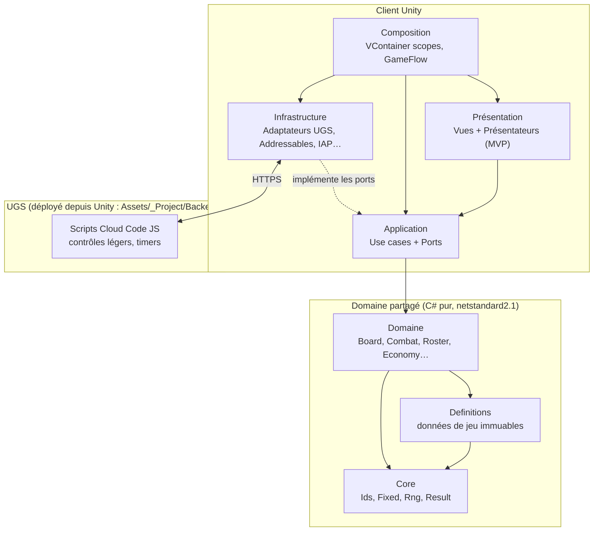

# Architecture logicielle — Vue d'ensemble

> Heroes Dawn · Unity 6.6 · Studio N29 · v1.0 (2026-09-29)
> Ce dossier est la référence pour tout le code du projet. Toute exception à une règle se note dans `05_Production/Decisions.md`.

## Sommaire
| Fichier | Contenu |
|---|---|
| `00_Vue_Ensemble.md` | Choix d'architecture, schéma global (ce fichier) |
| `01_Architecture.md` | Plateformes, services UGS, appareils cibles |
| `02_Couches_Assemblies_Dossiers.md` | Couches, assemblies (.asmdef), graphe de dépendances, arborescence du projet |
| `03_Modules_Domaine.md` | Chaque module métier : responsabilités, état, règles, API, événements |
| `04_Communication.md` | Commandes, requêtes, événements, bus de messages, flux détaillés |
| `05_Simulation_Deterministe.md` | Combat et plateau déterministes, vérification serveur, maths en virgule fixe |
| `06_Backend_Donnees.md` | Cloud Code, schéma de sauvegarde, Remote Config, pipeline de contenu, localisation |
| `07_Presentation_Flux.md` | MVP, scènes, machine d'états du jeu, UI, audio |
| `08_Regles_Conventions.md` | Règles de code, conventions de nommage, interdits, checklist de revue |
| `09_Tests_Outils_CI.md` | Stratégie de test, outils éditeur, simulateur, intégration continue |

## Le choix : couches « Clean » + MVP + simulation pure

### Pourquoi pas un MVC classique
Dans Unity, un MonoBehaviour mélange souvent vue et contrôleur, et le « modèle » finit dans des composants de scène. Résultat : logique impossible à tester sans lancer le jeu, et impossible à exécuter sur le serveur. Or Heroes Dawn a deux besoins qui imposent une séparation plus stricte :
1. **L'économie est contrôlée côté serveur** (scripts Cloud Code JS déployés depuis Unity) : le client calcule les règles, le serveur applique des **contrôles légers** (plafonds, idempotence, heure serveur, monnaies via Economy). Décision 2026-10-02 : tout se passe dans Unity, pas de projet .NET séparé.
2. **Le combat ATB et le plateau doivent être rejouables à l'identique** (tests, simulateur d'équilibrage, lecteur de journaux dans l'éditeur).

### L'architecture retenue
| Couche | Patron | Rôle |
|---|---|---|
| **Domaine** (C# pur) | Modèle riche + systèmes de règles + simulation déterministe | Tout le game design exécutable : plateau, combat, roster, économie… Aucune référence à Unity. **Partagé avec le serveur.** |
| **Application** (C# pur) | Cas d'usage (use cases) + ports (interfaces) | Orchestre le domaine, parle au backend via des interfaces, publie les événements. |
| **Infrastructure** (Unity + SDK) | Adaptateurs (architecture hexagonale) | Implémente les ports : UGS, sauvegarde, Addressables, IAP, Steam, analytics, localisation. |
| **Présentation** (Unity) | **MVP** : Vue passive + Présentateur | Affiche l'état, joue les animations, transmet les intentions du joueur. Aucune règle de jeu. |
| **Composition** (Unity) | Injection de dépendances (VContainer) | Assemble tout au démarrage et par scène. |

**MVP plutôt que MVC ou MVVM** : la vue (MonoBehaviour) reste passive et bête ; le présentateur (classe C# pure injectée) est testable sans scène ; le data-binding MVVM n'apporte pas assez pour un jeu à animations lourdes.

**Combat = simulation + « lecteur »** : la simulation produit un journal d'événements (`CombatEvent`), la présentation le **joue** avec ses timings et animations. C'est le même principe que l'architecture événementielle multi-rendus de Polo Rivals.

## Schéma global

## Principes directeurs
1. **Le domaine ne connaît personne.** Il ne référence ni Unity, ni le réseau, ni la présentation.
2. **Une règle de jeu n'existe qu'à un endroit** : dans le domaine, exécuté à l'identique par le client (affichage, prédiction) et le serveur (autorité).
3. **Le serveur a toujours raison** sur tout ce qui touche aux monnaies, au temps réel et aux récompenses.
4. **Déterminisme** : même graine + mêmes entrées = même résultat, partout (entiers et virgule fixe, jamais de `float` dans la simulation).
5. **Données, pas code** : le contenu (recrues, compétences, plateaux, événements) est de la donnée ; ajouter une ville ne demande pas de code.
6. **Dépendances vers l'intérieur uniquement** : Présentation → Application → Domaine → Core.
7. **Communication explicite** : commandes pour agir, requêtes pour lire, événements pour notifier. Pas de singleton global, pas de `FindObjectOfType`.

## Bibliothèques retenues
| Besoin | Choix | Raison |
|---|---|---|
| Injection de dépendances | **VContainer** | Rapide, pensé pour Unity, scopes par scène |
| Bus de messages | **MessagePipe** | Pub/sub typé, s'intègre à VContainer, sans allocation |
| Asynchrone | **UniTask** | Async/await sans allocation, annulation par scope |
| Animations UI / tweens | **PrimeTween** | Sans allocation, API simple |
| Tests | NUnit (Unity Test Framework), lancés dans l'éditeur ou en batchmode | Tout dans Unity |
| Backend | Unity Gaming Services SDK | Voir `01_Architecture.md` |
| Plateforme PC | Steamworks.NET | Authentification et microtransactions Steam |

Versions à figer dans `Packages/manifest.json` au démarrage du prototype, après vérification de la compatibilité avec Unity 6.6.

## Ce que l'on ne fait pas (et pourquoi)
| Écarté | Raison |
|---|---|
| ECS / DOTS | Peu d'entités à l'écran, coût d'apprentissage et d'outillage trop élevé pour 1-2 personnes |
| Singletons `Manager.Instance` | Couplage caché, tests impossibles, ordre d'initialisation fragile |
| Logique dans les ScriptableObjects | Les SO sont des données ; l'état mutable à l'exécution y serait persistant dans l'éditeur |
| MVVM avec binding générique | Surcoût de mise en place sans gain réel pour un jeu piloté par les animations |
| Réseau temps réel (Netcode) | Aucun multijoueur synchrone prévu ; le PvP asynchrone passe par Cloud Code |
