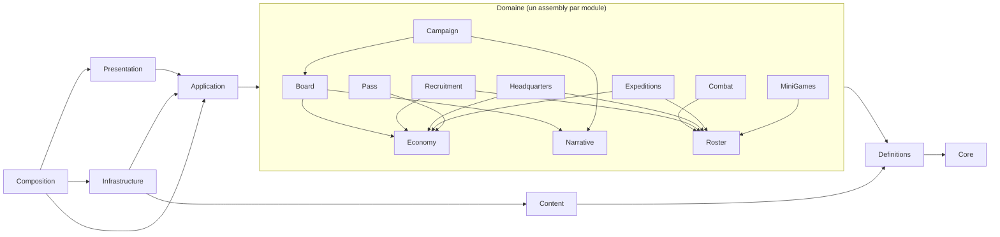

# Couches, assemblies et arborescence

## Espace de noms racine
`N29.HeroesDawn` — chaque assembly ajoute son suffixe (`N29.HeroesDawn.Domain.Combat`). **Espace de noms = assembly = dossier.**

## Assemblies (.asmdef)
| Assembly | Couche | Unity ? | Références autorisées | Contenu |
|---|---|---|---|---|
| `N29.HeroesDawn.Core` | Core | **Non** (`noEngineReferences`) | — | Ids typés, `Fixed`, `IRandom`/`Pcg32`, `Result<T>`, `IDomainEvent`, collections déterministes |
| `N29.HeroesDawn.Definitions` | Core | Non | Core | Définitions immuables du contenu (`MemberDef`, `SkillDef`, `ZoneDef`…) et `BalanceConfig` |
| `N29.HeroesDawn.Domain.*` (un par module) | Domaine | Non | Core, Definitions, autres modules **listés** (voir graphe) | État + règles + simulation |
| `N29.HeroesDawn.Application` | Application | Non | Core, Definitions, Domain.*, **UniTask, MessagePipe** | Use cases (`Features/<Feature>/`), messages (`Messages/`), ports, `GameSession` + `ISessionReadModel`, `SaveScheduler` |
| `N29.HeroesDawn.Infrastructure` | Infrastructure | Oui | Application, Domain.*, Definitions, Core, UniTask + SDK UGS, Addressables, IAP, Steamworks | Adaptateurs des ports |
| `N29.HeroesDawn.Content` | Infrastructure | Oui | Definitions, Core | ScriptableObjects d'édition + conversion vers Definitions |
| `N29.HeroesDawn.Presentation` | Présentation | Oui | Application (interfaces de use cases, modèles de lecture, messages), Definitions, Core, UniTask, MessagePipe | Vues, présentateurs, UI, audio |
| `N29.HeroesDawn.Composition` | Composition | Oui | **Tout** (dont VContainer, MessagePipe.VContainer) | `RootLifetimeScope`, `GameBootstrap` (point d'entrée) ; GameFlow et scopes de scène au sous-projet 2 |
| `N29.HeroesDawn.Editor` | Outils | Éditeur | Tout | Éditeur de plateau, import d'équilibrage, simulateur |
| `N29.HeroesDawn.Tests.Domain` | Tests | Non | Core, Definitions, Domain.*, Application, Content, UniTask, MessagePipe | Tests unitaires (Test Runner ou batchmode) |
| `N29.HeroesDawn.Tests.Editor` | Tests | Éditeur | Editor, Content, Domain.* | Tests des outils éditeur et de la configuration backend |
| `N29.HeroesDawn.Tests.PlayMode` | Tests | Oui | Tout | Tests d'intégration en scène |

Réglages des assemblies pures : `noEngineReferences: true`, `autoReferenced: false`, `overrideReferences: true` (aucune DLL implicite).

**Packages figés (OpenUPM, 2026-10-02)** : VContainer 1.19.0, UniTask 2.5.11, MessagePipe 1.8.2, MessagePipe.VContainer 1.8.2. `Core`, `Definitions` et `Domain.*` n'en référencent aucun (test `DependencyGuardTests`).

## Graphe de dépendances


**Règles du graphe**
- Aucune flèche vers le haut. Aucune dépendance circulaire (Unity la refuse de toute façon entre assemblies).
- Deux modules du domaine qui ont besoin l'un de l'autre → l'orchestration remonte dans **Application**.
- `Presentation` ne référence **jamais** `Infrastructure` ni un `Domain.*` en écriture : elle lit des **vues en lecture seule** (interfaces `IReadOnly…`) et appelle des **use cases**.

## Code partagé
Le code de `Core`, `Definitions` et `Domain.*` vit dans un **package local** compilé par Unity via les `.asmdef`. Il n'est plus compilé hors de Unity (décision 2026-10-02 : pas de module Cloud Code C#, pas de `dotnet test`) ; il reste du C# pur pour être testable et rejouable.

Cible commune : **netstandard2.1**, C# 9 (pas de fonctionnalités plus récentes dans le code partagé).

## Arborescence du dépôt
```
HeroesDawn/
├─ Unity/                                  ← projet Unity 6.6
│  ├─ Assets/
│  │  ├─ _Project/
│  │  │  ├─ Composition/                   N29.HeroesDawn.Composition
│  │  │  │  ├─ Scopes/                     RootLifetimeScope, HubScope, BoardScope, CombatScope
│  │  │  │  └─ Flow/                       GameFlowMachine, états
│  │  │  ├─ Application/                   N29.HeroesDawn.Application
│  │  │  │  ├─ Ports/                      IBackendGateway, ISaveGateway, IClock, IContentProvider…
│  │  │  │  ├─ Session/                    GameSession, ProfileSnapshot
│  │  │  │  └─ Features/<Feature>/         UseCases, Handlers, Messages
│  │  │  ├─ Infrastructure/                N29.HeroesDawn.Infrastructure
│  │  │  │  ├─ Ugs/                        Auth, CloudCode, CloudSave, Economy, RemoteConfig, Analytics
│  │  │  │  ├─ Platform/                   Steam, GooglePlay, Apple, IAP
│  │  │  │  ├─ Content/                    AddressablesContentProvider
│  │  │  │  └─ Services/                   Localization, Audio backend, Logging
│  │  │  ├─ Content/                       N29.HeroesDawn.Content (ScriptableObjects d'édition)
│  │  │  ├─ Presentation/                  N29.HeroesDawn.Presentation
│  │  │  │  ├─ Common/                     ViewBase, UI kit comics, pools, transitions
│  │  │  │  └─ Features/<Feature>/         Views/, Presenters/
│  │  │  ├─ Editor/                        N29.HeroesDawn.Editor
│  │  │  ├─ Art/  Audio/  Prefabs/  Scenes/  Localization/
│  │  │  ├─ AddressableGroups/             Core, Hub, Board, Combat, City_NewYork…
│  │  │  └─ Backend/                       CloudCode/ (JS), Economy/ (.ecc), RemoteConfig/ (balance.rc) — déployés par Window ▸ Deployment
│  │  └─ Tests/                            Domain/, Editor/, PlayMode/
│  └─ Packages/
│     └─ com.n29.heroesdawn.domain/        ← code partagé
│        ├─ Core/
│        ├─ Definitions/
│        └─ Domain/<Module>/
└─ Docs/  → lien vers « Documents/Heroes Dawn »
```

## Organisation d'un module du domaine (exemple : Combat)
```
Domain/Combat/
├─ N29.HeroesDawn.Domain.Combat.asmdef
├─ State/          CombatState, UnitState, TeamSide, StatusInstance
├─ Rules/          AtbRules, DamageFormula, StatusRules, ComboRules, TargetingRules
├─ Ai/             AllyAutoAi, EnemyAi (par rang), BossPhases
├─ Simulation/     CombatSimulation, CombatCommand, CombatInputLog
├─ Events/         CombatEvent (UnitActed, DamageDealt, StatusApplied, ComboTriggered…)
└─ Api/            ICombatReadModel, CombatResult, CombatSetup
```

## Organisation d'une fonctionnalité (Application + Présentation)
```
Application/Features/Recruitment/
├─ UseCases/      RecruitMemberUseCase, RefreshPoolUseCase
├─ Messages/      MemberRecruited, PoolRefreshed (événements publiés sur le bus)
└─ Handlers/      (réactions transverses, voir 04_Communication)

Presentation/Features/Recruitment/
├─ Views/         RecruitmentScreenView, RecruitCardView
└─ Presenters/    RecruitmentPresenter
```
