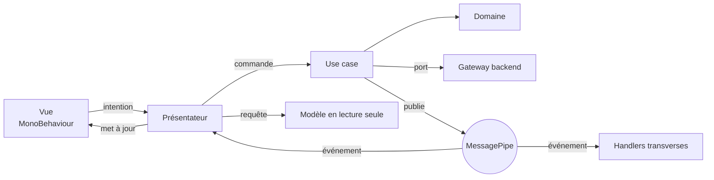
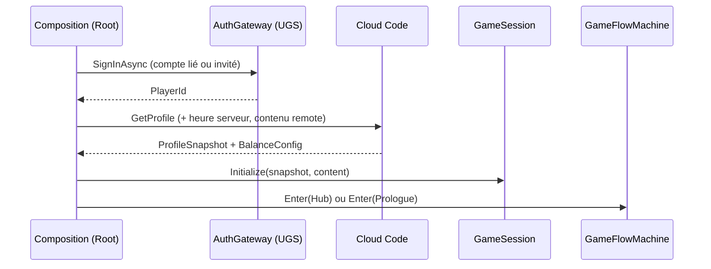
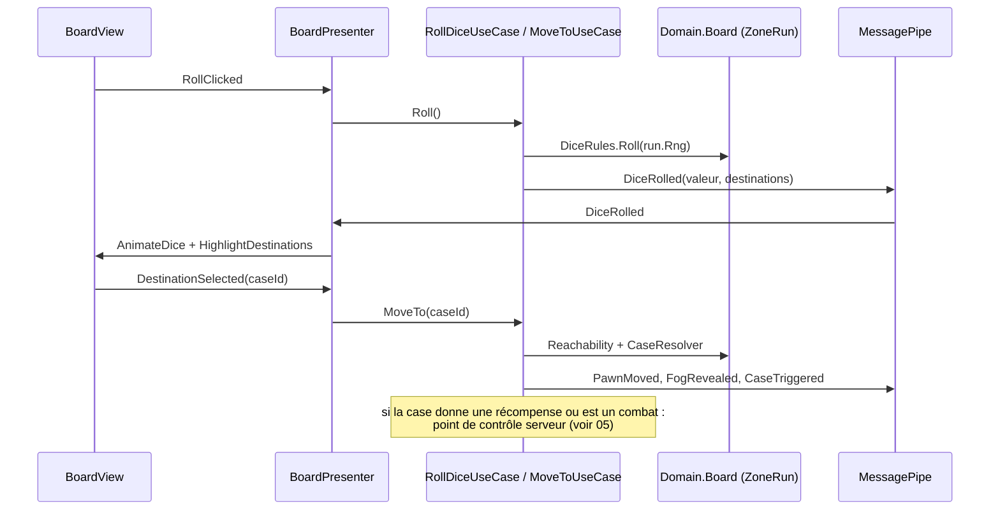
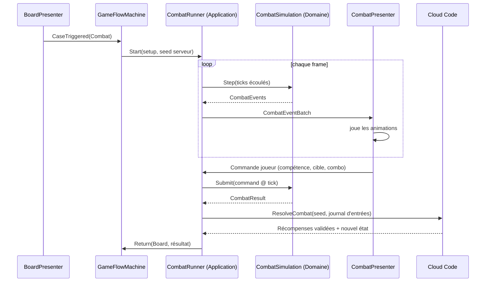

# Communication entre les scripts

## Les 4 canaux (et seulement ceux-là)
| Canal | Sens | Forme | Exemple |
|---|---|---|---|
| **Commande** | Présentateur → Application | Appel d'une méthode d'un use case injecté, `async`, renvoie `Result` | `await _recruit.ExecuteAsync(memberId, ct)` |
| **Requête** | Présentateur → Application | Lecture d'un modèle en lecture seule ou d'un instantané | `_session.Roster.Get(memberId)` |
| **Événement** | Application → abonnés | Message immuable publié sur **MessagePipe** après validation de l'état | `MemberRecruited` |
| **Intention de vue** | Vue → Présentateur | `event Action` C# ou callback sur la vue (jamais le bus) | `view.RecruitClicked += OnRecruitClicked` |

Tout le reste est interdit : pas d'appel direct Vue → use case, pas de `SendMessage`, pas de `static event` global, pas de `UnityEvent` câblé dans l'inspecteur pour de la logique.

## Qui parle à qui


## Commandes : les use cases
- Un use case = **une intention du joueur** (`RollDice`, `MoveTo`, `RecruitMember`, `UpgradeRoom`, `StartExpedition`…).
- Interface + implémentation (`IRecruitMemberUseCase` / `RecruitMemberUseCase`), enregistrée dans le scope VContainer adapté.
- Séquence type : **vérifier** (règles du domaine, pour un retour immédiat) → **appeler le serveur** si l'action est autoritaire → **appliquer** la réponse à la session → **publier** les événements.

```csharp
public sealed class RecruitMemberUseCase : IRecruitMemberUseCase
{
    readonly GameSession _session;
    readonly IEconomyGateway _economy;          // port, implémenté par Infrastructure
    readonly IPublisher<MemberRecruited> _recruited;
    readonly IPublisher<CurrencyChanged> _currency;

    public async UniTask<Result> ExecuteAsync(MemberId id, CancellationToken ct)
    {
        var check = RecruitmentRules.CanRecruit(_session.Pool, _session.Wallet, id, _session.Content);
        if (check.IsFailure) return check;                       // retour immédiat à l'UI

        var response = await _economy.RecruitAsync(id, ct);      // Cloud Code : autorité
        if (response.IsFailure) return response;

        _session.Apply(response.Value);                          // nouvel état (wallet, roster, pool)
        _currency.Publish(new CurrencyChanged(_session.Wallet.Snapshot()));
        _recruited.Publish(new MemberRecruited(id));
        return Result.Ok();
    }
}
```

## Requêtes : lire l'état
- `GameSession` détient les agrégats du joueur et expose des **interfaces en lecture seule** (`IRosterReadModel`, `IWalletReadModel`, `IZoneRunReadModel`…).
- Les présentateurs lisent au moment d'afficher, puis se mettent à jour sur événement. Ils ne gardent pas de copie de l'état.

## Événements : MessagePipe
- Un type de message = un `readonly record struct` (ou `sealed record`) dans `Application/Features/<Feature>/Messages`.
- Publiés **uniquement par l'Application**, après que l'état de la session est à jour. Le domaine renvoie ses `IDomainEvent` au use case, qui les traduit et les publie.
- Abonnement dans le présentateur (ou le handler) avec `DisposableBag` lié au scope : désabonnement automatique à la destruction de la scène.

```csharp
public sealed class WalletPresenter : IStartable, IDisposable
{
    readonly IWalletView _view;
    readonly IWalletReadModel _wallet;
    readonly ISubscriber<CurrencyChanged> _changed;
    IDisposable _subscription;

    public void Start()
    {
        _view.Show(_wallet.Credits, _wallet.Pr, _wallet.Gems);
        _subscription = _changed.Subscribe(e => _view.AnimateTo(e.Credits, e.Pr, e.Gems));
    }
    public void Dispose() => _subscription?.Dispose();
}
```

### Catalogue des messages (extrait)
| Domaine | Messages |
|---|---|
| Session | `SessionReady`, `ServerTimeSynced`, `ConnectionLost`, `ConnectionRestored` |
| Économie | `CurrencyChanged`, `RewardGranted`, `PurchaseCompleted` |
| Roster | `MemberRecruited`, `MemberLeveledUp`, `PalierReached`, `FatigueChanged` |
| Plateau | `ZoneOpened`, `DiceRolled`, `PawnMoved`, `FogRevealed`, `CaseTriggered`, `ObjectiveCompleted`, `ZoneValidated`, `ZoneLeft` |
| Combat | `CombatStarted`, `CombatEventBatch` (flux de la simulation), `ComboAvailable`, `CombatEnded` |
| Campagne | `ZoneUnlocked`, `ActCompleted`, `LegendUnlocked` |
| QG | `RoomUpgraded`, `TrainingCompleted`, `ExpeditionReturned`, `LabCollected`, `SideObjectivesSpawned` |
| Pass | `PassXpGained`, `PassTierReached`, `MissionCompleted`, `AchievementUnlocked` |
| Navigation | `NavigateTo(Screen)`, `ModalRequested` |

## Handlers transverses : règles de câblage
Une réaction qui **change l'état de jeu** doit être **explicite dans le use case** (lisible en un endroit). Les handlers sur le bus sont réservés aux effets secondaires **sans impact sur les règles** :
| Autorisé dans un handler | Interdit dans un handler |
|---|---|
| Analytics, succès et missions *affichés* (le serveur les valide), sons, notifications, badges, préchargement | Donner des monnaies, changer la progression, déclencher un combat, modifier le roster |

Exemple : la victoire de combat → XP, fatigue, progression d'objectif sont appliqués par `ResolveCombatUseCase` (une seule opération serveur). Un handler écoute `CombatEnded` pour envoyer l'analytics et jouer le jingle.

## Intentions de vue
- Chaque vue expose une **interface** (`IRecruitmentView`) : méthodes d'affichage + événements C# d'intention.
- La vue ne connaît ni le présentateur, ni le bus, ni la session. Le présentateur reçoit l'interface par injection.

```csharp
public interface IRecruitmentView
{
    event Action<MemberId> RecruitClicked;
    event Action RefreshClicked;
    void ShowPool(IReadOnlyList<RecruitCardData> cards, RefreshCostData refresh);
    void ShowError(LocalizedMessage message);
    void PlayRecruitAnimation(MemberId id);
}
```

## Flux détaillés

### 1. Démarrage


### 2. Lancer le dé et se déplacer


### 3. Combat sur une case


### 4. Retour au QG et timers
- Au retour sur le hub, `SyncTimersUseCase` appelle `GetTimers` (Cloud Code) : entraînement, expéditions, labo, objectifs secondaires, pool du jour, tous calculés avec **l'heure serveur**.
- Le client affiche des comptes à rebours locaux (`IClock` corrigé du décalage serveur) ; il ne décide jamais qu'un timer est terminé.

## Gestion des erreurs
| Type | Traitement |
|---|---|
| Échec métier attendu (`Result.Failure`) | Message localisé à l'écran, pas de log d'erreur |
| Refus du serveur (état désynchronisé) | Rechargement du profil (`GetProfile`), puis message neutre |
| Réseau indisponible | 3 tentatives avec attente croissante (0,5 s, 1 s, 2 s), puis écran « Connexion perdue » bloquant ; reprise automatique |
| Exception (bug) | Log + rapport (Cloud Diagnostics), retour au hub si possible |
