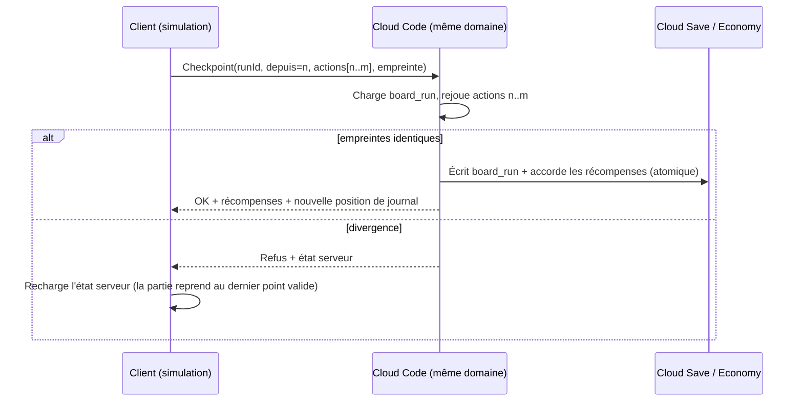

# Simulation déterministe et vérification serveur

## Objectif
Le combat et le plateau tournent **sur le client** (réactivité, pas de latence), mais le serveur doit pouvoir **rejouer exactement** la même partie pour valider les récompenses. Même code (domaine partagé), même graine, mêmes entrées → même résultat.

## Règles de déterminisme (obligatoires dans `Core`, `Definitions`, `Domain.*`)
1. **Pas de `float` ni de `double`** dans les calculs de simulation. Entiers (`int`, `long`) et `Fixed` (virgule fixe 32.32).
2. **Aléatoire uniquement via `IRandom`** (PCG32) reçu en paramètre. Interdit : `UnityEngine.Random`, `System.Random`, `Guid.NewGuid()`.
3. **Temps uniquement en ticks** de simulation (combat) ou en `GameTime` serveur (timers). Interdit : `Time.deltaTime`, `DateTime.Now`.
4. **Ordre stable** : jamais d'itération sur `Dictionary`/`HashSet` pour décider d'un ordre ; tri explicite par Id à égalité.
5. **Pas d'état statique mutable.**
6. **Pas de LINQ** dans les boucles de simulation (allocations et ordre implicite).
7. Toute nouvelle règle arrive avec un **test de rejeu** (voir `09_Tests_Outils_CI.md`).

## Combat
### Horloge
- La simulation avance par **ticks fixes de 50 ms** (20 ticks/s).
- `CombatRunner` (Application) accumule le temps réel de la frame (× vitesse ×1/×2) et appelle `Step(n)` avec le nombre de ticks entiers écoulés. La présentation interpole entre deux ticks.
- Jauge ATB : `jauge += VIT × facteur × 50 ms`, calculée en entiers (points × 1 000).

### Entrées
- Une commande = `(tick, acteur, compétence | combo, cible)`.
- **Mode manuel** : quand une jauge est pleine, l'unité attend ; la commande est appliquée **au tick où le joueur valide**. Les autres jauges continuent (temps actif).
- **Mode auto** : l'IA génère la commande au tick où la jauge est pleine ; elle est aussi enregistrée (le journal est complet dans les deux modes).
- Changer de mode, retraite : commandes du journal comme les autres.

### Sortie
- Un flux ordonné de `CombatEvent` (tick, type, données) : `GaugeFull`, `SkillUsed`, `DamageDealt`, `Healed`, `StatusApplied/Expired`, `ComboAvailable/Triggered`, `UnitDefeated`, `PhaseChanged`, `CombatEnded`.
- La présentation **ne calcule rien** : elle joue ces événements.

### Journal et empreinte
```text
CombatInputLog
  version_regles   (hash du contenu + version du code partagé)
  graine           (fournie par le serveur à l'ouverture du combat)
  setup            (équipe : ids, niveaux, fatigue ; ennemis : ids, niveaux, rang)
  commandes[]      (tick, acteur, action, cible)
  resultat_client  (victoire/défaite, tick final, empreinte de l'état final)
```
L'**empreinte** = hachage (FNV-1a 64) de l'état final (PV, statuts, tick). Le serveur la compare à la sienne.

## Plateau
- À l'ouverture d'une zone, le serveur fournit une **graine de zone** et l'état sauvegardé (`board_run`).
- Flux RNG séparés (`Fork`) : dé, retirage des pools, résolution des cases, événements.
- Le client simule librement ; le journal enregistre : lancers, dés bonus, destinations, choix d'événements, résultats de mini-jeux.

## Points de contrôle (checkpoints)
Le client envoie le journal au serveur **à chaque case qui donne quelque chose** (ressource, combat, mini-jeu, événement, objectif) — ce qui sert aussi de **sauvegarde de zone reprenable**.



- Coût : 1 appel par case significative (environ 10-15 par zone), acceptable pour Cloud Code.
- Latence : l'animation de la case masque l'appel ; les récompenses s'affichent à la réponse.
- Combat : checkpoint unique à la fin (`ResolveCombat`), qui rejoue le journal de combat.

## Ce que le serveur rejoue, ce qu'il ne rejoue pas
| Élément | Rejoué | Vérification |
|---|---|---|
| Déplacements, dés, pools, cases | Oui | Rejeu complet |
| Combat | Oui | Rejeu complet + empreinte |
| Événements narratifs | Oui | Choix valide + tirage |
| Mini-jeux d'adresse (Démonstration, Piratage, Poursuite) | Non | Plausibilité : durée ≥ minimum, nombre d'entrées cohérent, taux de réussite du joueur suivi |
| Intervention | Oui | Tirage avec la graine |

## Versionnement des règles
- Chaque build embarque `RulesVersion` (hash des définitions + version du package partagé).
- Le serveur accepte la version courante et la précédente pendant un déploiement ; au-delà, il demande une mise à jour de l'application.
- Une zone en cours avec une ancienne version est **terminée avec l'ancienne** (le module Cloud Code garde N-1).

## Performances
- Combat : ≤ 0,2 ms par tick sur un Android d'entrée de gamme (cible), zéro allocation par tick (structs, tableaux pré-alloués, pools d'événements).
- Rejeu serveur d'un combat de 90 s (1 800 ticks) : < 20 ms.
