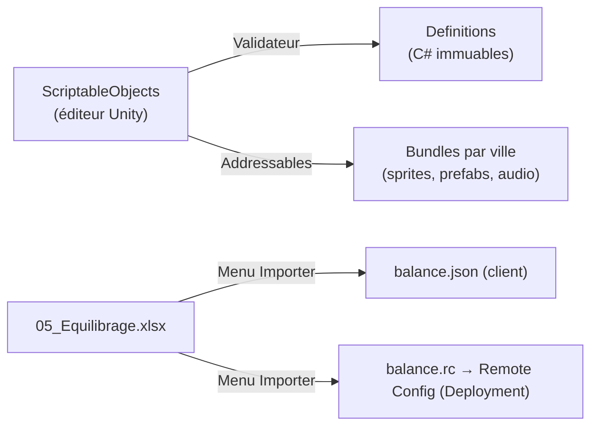

# Backend (UGS) et données

## Ports (interfaces côté Application) et adaptateurs
| Port | Adaptateur (Infrastructure) | Rôle |
|---|---|---|
| `IAuthGateway` | `UgsAuthGateway` + `SteamAuthProvider`, `GooglePlayAuthProvider`, `AppleAuthProvider` | Connexion, liaison de comptes |
| `IProfileGateway` | `CloudCodeProfileGateway` | Lecture du profil complet, heure serveur |
| `IEconomyGateway` | `CloudCodeEconomyGateway` | Recrutement, renouvellement, paliers, améliorations, boutique |
| `IBoardGateway` | `CloudCodeBoardGateway` | Ouverture de zone, checkpoints, quitter la zone |
| `ICombatGateway` | `CloudCodeCombatGateway` | Graine de combat, résolution |
| `IHeadquartersGateway` | `CloudCodeHqGateway` | Entraînement, infirmerie, expéditions, labo, timers |
| `IPassGateway` | `CloudCodePassGateway` | Réclamer un palier, missions |
| `IPurchaseGateway` | `UnityIapGateway`, `SteamMicroTxnGateway` | Achats réels, validation des reçus |
| `IRemoteConfig` | `UgsRemoteConfig` | `BalanceConfig`, événements, A/B |
| `IContentProvider` | `AddressablesContentProvider` | Définitions, prefabs, sprites par ville |
| `IAnalytics` | `UgsAnalytics` | Événements analytics (avec consentement) |
| `ILocalization` | `UnityLocalizationService` | Textes et formats |
| `IClock` | `ServerSyncedClock` | Heure corrigée du décalage serveur |
| `ILogger` | `UnityLogger` (+ Cloud Diagnostics) | Journalisation |

Chaque port a aussi une implémentation **factice** (`Fake…`) pour les tests et le mode hors ligne du développement.

## Cloud Code — scripts JS déployés depuis Unity
Un script par point d'entrée dans `Assets/_Project/Backend/CloudCode/<PointDEntrée>.js`, déployé par *Window ▸ Deployment* (décision 2026-10-02 : tout dans Unity, pas de module C# séparé). Le client calcule les règles ; le serveur applique des **contrôles légers** et ne rejoue pas les parties : plafonds de gain lus dans la clé Remote Config `balance`, cohérence des entrées, heure serveur, débits et crédits par Economy.

| Point d'entrée | Entrée | Effet autoritaire | Sortie |
|---|---|---|---|
| `GetProfile` | — | Calcule les timers écoulés (entraînement, labo, expéditions, objectifs, pool du jour) | `ProfileSnapshot`, heure serveur, `RulesVersion` attendue |
| `CompletePrologue` | Choix de la 1re recrue | Ajoute la recrue, débloque le QG | Snapshot partiel |
| `Recruit` | `memberId` | Débite PR, ajoute au roster, retire de la pool | Wallet, roster, pool |
| `RefreshPool` | — | Débite (gratuit / Crédits / gemmes), retire la pool | Pool, wallet |
| `ValidatePalier` | `memberId`, palier | Débite Crédits | Membre |
| `UpgradeRoom` | `roomId` | Débite Crédits, vérifie le plafond | Room, wallet |
| `AssignTraining` / `AssignInfirmary` | `memberId`, slot, objets | Démarre le timer | HQ |
| `StartExpedition` / `ClaimExpedition` | membres, zone, durée | Timer / récompenses | HQ, wallet |
| `CollectLab` | — | Accorde les PR accumulés | Wallet |
| `OpenZone` | `zoneId`, difficulté, équipe | Crée ou reprend `board_run`, donne la graine | État de zone |
| `Checkpoint` | `runId`, état résumé, gains déclarés | Vérifie la cohérence et les plafonds, sauvegarde, accorde les récompenses | Récompenses, état |
| `StartCombat` | `runId`, `caseId` | Graine de combat | Seed, setup ennemi |
| `ResolveCombat` | résultat, durée, empreinte | Vérifie la plausibilité (rang, durée minimale, plafonds), XP, fatigue, récompenses, progression | Résultat validé |
| `LeaveZone` | `runId` | Ferme le brouillard, conserve les objectifs | État de campagne |
| `ClaimPassTier` | palier, piste | Récompense | Wallet, pass |
| `ClaimMission` / `ClaimAchievement` | id | Récompense | Wallet, pass |
| `ValidatePurchase` | reçu (store) | Crédite les gemmes / le pass | Wallet, pass |

**Règles serveur**
- Chaque point d'entrée est **idempotent** : il reçoit un `requestId` ; un rejeu du même `requestId` renvoie la même réponse sans re-créditer.
- Écritures Cloud Save avec **contrôle de version** (écriture refusée si la clé a changé entre lecture et écriture).
- Les monnaies passent **uniquement** par UGS Economy (débit/crédit atomiques côté service).

## Schéma de sauvegarde (Cloud Save, par joueur)
| Clé | Contenu | Taille visée |
|---|---|---|
| `profile` | Version du schéma, drapeaux (prologue, tutoriels vus), paramètres, ville courante, `lastSeen` | < 2 Ko |
| `roster` | Membres possédés : id, niveau, XP, paliers, fatigue (valeur + horodatage), affectation, cosmétiques équipés | < 20 Ko |
| `campaign` | Par ville : acte, zones validées, zones difficiles validées, Légendes débloquées | < 4 Ko |
| `board_run` | Zone en cours : id, graine, position de journal, état résumé (position, révélées, contenus, objectifs, PM, dés) | < 8 Ko |
| `hq` | Niveaux des pièces, slots (membre, début, fin), expéditions, labo (dernière collecte), objectifs secondaires | < 6 Ko |
| `recruitment` | Pool du jour (date, offres), renouvellements du jour | < 1 Ko |
| `pass` | Saison, XP, paliers réclamés, premium, missions du jour, succès | < 4 Ko |
| `cosmetics` | Inventaire, équipements | < 2 Ko |

Chaque clé porte un champ `schemaVersion` ; les migrations sont écrites côté serveur (`Migrations/V2_…`).

## UGS Economy
| Type | Identifiants |
|---|---|
| Monnaies | `CREDITS`, `PR`, `GEMS` (achetables), `EVENT_TOKEN` (par saison) |
| Objets d'inventaire | `ITEM_TRAINING_*`, `ITEM_MEDKIT`, `ITEM_LOADED_DIE`, `ITEM_STIM`, `ITEM_FLARE`, `ITEM_SPEEDUP_15M/1H/8H` |
| Achats réels | `GEMS_100` … `GEMS_6000`, `WELCOME_PACK`, `PASS_PREMIUM_S<n>` |

## Remote Config
- Une clé JSON `balance` = tout `BalanceConfig` (généré depuis `05_Equilibrage.xlsx` par le menu *Heroes Dawn ▸ Équilibrage ▸ Importer*, qui écrit `Assets/_Project/Backend/RemoteConfig/balance.rc` et `Resources/Balance/balance.json`).
- Clés séparées : `season` (id, dates, paliers), `event` (id, dates, mini-plateau), `shop_rotation`, `feature_flags`.
- Le serveur lit **la même** configuration que le client (Remote Config lu par les scripts Cloud Code ; le client embarque le même `balance.json`) : une valeur ne peut pas différer entre les deux.

## Pipeline de contenu

- **Validateur de contenu** (menu éditeur + CI) : ids uniques, références valides, 4 compétences par recrue, pools non vides, objectifs atteignables, clés de localisation existantes.
- `RulesVersion` (hash des définitions) est calculé dans Unity et envoyé avec chaque appel serveur.

### Groupes Addressables
| Groupe | Contenu | Chargement |
|---|---|---|
| `Core` | UI commune, polices, sons d'interface | Au démarrage |
| `Hub` | QG, pièces, cosmétiques du QG | Entrée au hub |
| `Board_Common`, `Combat_Common` | Éléments génériques | Première mission |
| `City_NewYork` | Plateaux, portraits, ennemis, musiques de la ville | Sélection de la ville |
| `Season_<n>` | Pass, événement, cosmétiques | Début de saison |

## Localisation
- Unity Localization, **une table par domaine** : `UI`, `Members`, `Skills`, `Narrative_NY`, `Tutorial`, `Shop`, `Errors`.
- Clés : `domaine.objet.champ` (ex. `members.verre.bio`, `skills.givre_a3.name`).
- Aucun texte en dur dans le code ou les prefabs ; le validateur échoue sinon.
- Nombres et prix formatés par la culture ; prix réels fournis par le store.

## Analytics (taxonomie)
| Événement | Paramètres |
|---|---|
| `tutorial_step` | step (1-5) |
| `zone_opened` / `zone_validated` / `zone_left` | city, zone, difficulty, duration_s |
| `combat_ended` | zone, rank, result, duration_s, auto_ratio, combos_used |
| `member_recruited` | member, rarity, pool_refreshes |
| `room_upgraded` | room, level |
| `pass_tier` | season, tier, premium |
| `purchase` | product, price, currency, source_screen |
| `session_end` | length_s, screens_visited |

Envoyés seulement après consentement (RGPD) ; identifiants de joueur pseudonymisés.
