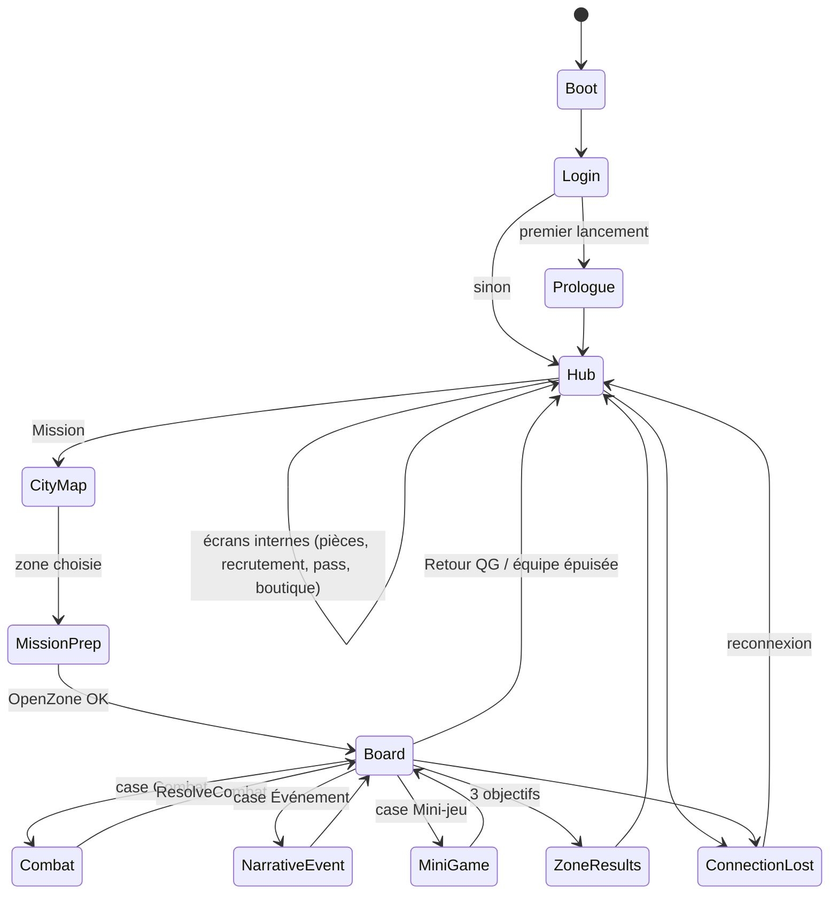
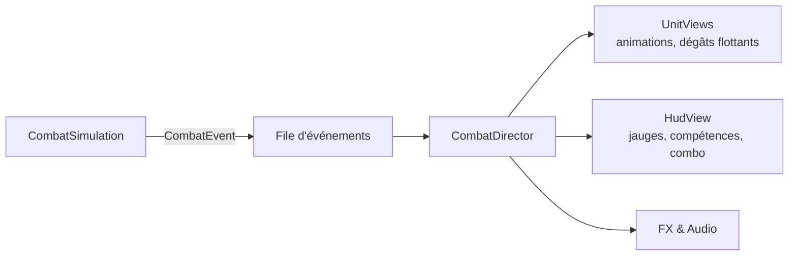

# Présentation, scènes et flux de jeu

## MVP : les trois pièces
| Pièce | Type | Fait | Ne fait jamais |
|---|---|---|---|
| **Vue** | `MonoBehaviour` + interface `I…View` | Affiche des données prêtes, joue animations et sons, relaie les intentions (clics, gestes) | Lire la session, appeler un use case, calculer une règle |
| **Présentateur** | Classe C# pure, injectée (VContainer `IStartable`, `IDisposable`) | Lit l'état, formate (via `ILocalization`), écoute le bus, appelle les use cases | Toucher un `GameObject`, un `Transform`, un composant |
| **Données de vue** | `readonly struct …Data` | Transporte ce qu'il faut afficher (textes localisés, sprites, valeurs) | Contenir de la logique |

- **Une vue = un présentateur.** Les listes utilisent des sous-vues (`RecruitCardView`) pilotées par le présentateur parent.
- Les vues sont enregistrées dans le scope avec `RegisterComponentInHierarchy<RecruitmentScreenView>().As<IRecruitmentView>()`.

## Scènes
| Scène | Chargement | Scope VContainer | Contenu |
|---|---|---|---|
| `Boot` | Seule, au lancement | `RootLifetimeScope` (vit tout le jeu) | Services globaux, session, bus, flux de jeu, écran de chargement |
| `Hub` | Additive | `HubScope` | QG en coupe, pièces, recrutement, pass, boutique, équipe |
| `CityMap` | Additive | `CityMapScope` | Carte des 5 arrondissements, choix de zone, préparation |
| `Board` | Additive | `BoardScope` | Plateau, dé, brouillard, cases ; overlays Événement et Mini-jeu |
| `Combat` | Additive **par-dessus** Board (Board mis en pause, non déchargé) | `CombatScope` (enfant de BoardScope) | Arène, HUD, `CombatRunner` |
| `Prologue` | Additive | `PrologueScope` | Version scriptée de Board + Combat |

Les scopes enfants héritent des services du parent ; ils sont détruits avec leur scène (désabonnements automatiques).

## Machine d'états du jeu (`GameFlowMachine`)

- Chaque état implémente `IGameState { UniTask EnterAsync(Payload, ct); UniTask ExitAsync(ct); }`.
- Seule la machine d'états charge ou décharge des scènes. Un présentateur demande une navigation en publiant `NavigateTo(...)`.
- `NarrativeEvent` et `MiniGame` sont des **overlays** dans la scène Board (pas de chargement).

## Écrans internes et modales
- `ScreenStack` (dans le hub) : pile d'écrans avec retour arrière (bouton Android géré).
- `ModalService` : confirmations, récompenses, erreurs ; une seule modale à la fois, file d'attente.

## Combat : le lecteur d'événements

- `CombatDirector` (présentation) consomme la file au rythme des animations ; la simulation peut avoir **un peu d'avance** (jusqu'à 10 ticks), jamais de retard visible.
- Les jauges ATB affichées sont **interpolées** entre deux ticks.
- Vitesse ×2 : la simulation et le directeur accélèrent ensemble.

## Plateau : rendu
- `BoardView` construit le graphe depuis `ZoneDef` (positions des nœuds dans la définition) ; les cases sont des prefabs poolés par type.
- Brouillard : masque 2D (texture de révélation) mis à jour sur `FogRevealed`.
- Destinations surlignées à partir de `IZoneRunReadModel.Destinations` — la vue ne calcule jamais une distance.

## UI
- **uGUI** + kit « comics » (cadres, bulles, onomatopées) ; un `Canvas` par couche (fond, écran, HUD, modales, toasts) pour limiter les reconstructions.
- Tailles et marges pensées paysage 16:9 à 21:9 ; zones sûres (encoches) gérées par `SafeAreaFitter`.
- Accessibilité : taille de texte (3 niveaux), mode daltonien (icônes de famille), réduction des flashs, temps étendu des mini-jeux — réglages dans `profile`.
- Entrées : Input System, schémas **Tactile** et **Souris/Clavier** (raccourcis dans `03_Art_UI_UX/01_UX_Ecrans.md`).

## Audio
- `IAudioService` (présentation) : musique par état (hub, arrondissement, combat, boss) avec fondus, SFX par famille, voix de combat.
- Déclenché par les présentateurs ou par des handlers (jamais par le domaine).

## Pools et performance
- Pool d'objets pour : cases, dégâts flottants, FX, cartes de recrutement, lignes de liste.
- Atlases de sprites par groupe Addressables ; pas plus de 2 atlases actifs par écran.
- Cible : 60 i/s sur milieu de gamme, 30 i/s minimum sur entrée de gamme ; mémoire < 700 Mo.
