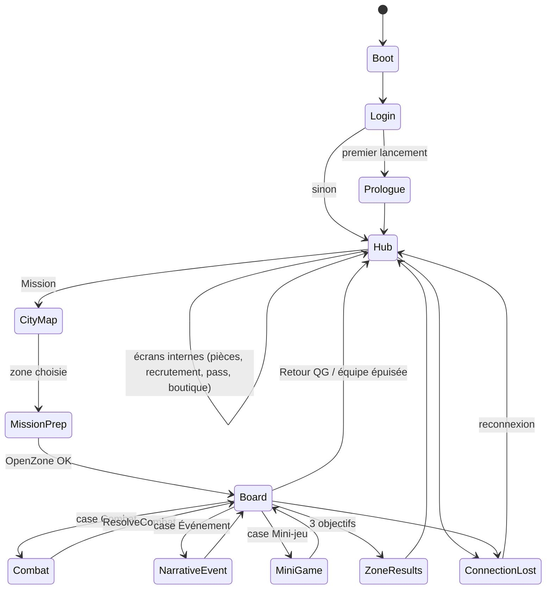
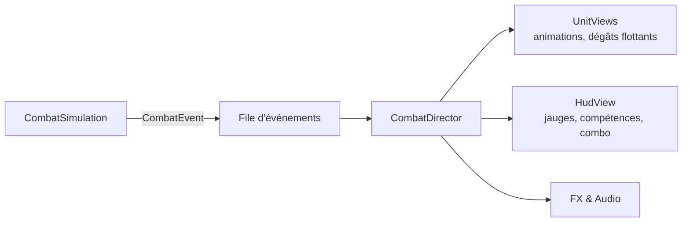

# Présentation, scènes et flux de jeu

## MVP : les trois pièces
| Pièce | Type | Fait | Ne fait jamais |
|---|---|---|---|
| **Vue** | `MonoBehaviour` + interface `I…View` | Affiche des données prêtes, joue animations et sons, relaie les intentions (clics, gestes) | Lire la session, appeler un use case, calculer une règle |
| **Présentateur** | Classe C# pure, injectée (VContainer `IStartable`, `IDisposable`) | Lit l'état, formate (via `ILocalization`), écoute le bus, appelle les use cases | Toucher un `GameObject`, un `Transform`, un composant |
| **Données de vue** | `readonly struct …Data` | Transporte ce qu'il faut afficher (textes localisés, sprites, valeurs) | Contenir de la logique |

- **Une vue = un présentateur.** Les listes utilisent des sous-vues (`RecruitCardView`) pilotées par le présentateur parent.
- Les vues sont enregistrées dans le scope avec `RegisterComponentInHierarchy<RecruitmentScreenView>().As<IRecruitmentView>()`.

## Scènes

> **État réel (sous-projet 2, 2026-10-03)** — scènes `Boot`, `Hub`, `Board`, `Combat` générées par *Heroes Dawn ▸ Setup ▸ Générer les scènes* (`Assets/_Project/Scenes`, Build Settings dans cet ordre). Chaque scène d'écran a un `SceneScreenScope` (`HubLifetimeScope`, `BoardLifetimeScope` enfants de `RootLifetimeScope` ; `CombatLifetimeScope` enfant de `BoardLifetimeScope`) qui instancie le prefab de son écran. `CityMap` et `Prologue` : M2.

> **État réel (sous-projet 3, 2026-10-03)** — les cinq écrans (connexion, QG, plateau, combat, résultats) et toutes les popups sont des **prefabs générés puis éditables** : *Heroes Dawn ▸ Setup ▸ Générer les prefabs d'écran* exécute les recettes éditeur (`Editor/Prefabs/Recipes`, une par écran ou widget) ; un prefab existant n'est **jamais écrasé** sans le demander (option « écraser »), les retouches à la main sont donc conservées. `ScreenCatalog` (`Settings/ScreenCatalog.asset`) associe chaque scène et chaque popup à son prefab. Chaque écran = une vue `MonoBehaviour` (`…View`, interface `I…View`) + un présentateur C# pur (`…Presenter`, base `PresenterBase`, testé en EditMode avec des doubles de vue). Textes en **TextMeshPro** (polices dynamiques encrées). Aucune interface n'est plus construite par code à l'exécution (garde-fou `NoCodeBuiltScreensTests`) ; les canvas de `Boot` (écrans d'ordre 10, couche modales + toasts d'ordre 100) sont dans la scène générée.
| Scène | Chargement | Scope VContainer | Contenu |
|---|---|---|---|
| `Boot` | Seule, au lancement | `RootLifetimeScope` (vit tout le jeu) | Services globaux, session, bus, flux de jeu, écran de chargement |
| `Hub` | Additive | `HubScope` | QG en coupe, pièces, recrutement, pass, boutique, équipe |
| `CityMap` | Additive | `CityMapScope` | Carte des 5 arrondissements, choix de zone, préparation |
| `Board` | Additive | `BoardScope` | Plateau, dé, brouillard, cases ; overlays Événement et Mini-jeu |
| `Combat` | Additive **par-dessus** Board (Board mis en pause, non déchargé) | `CombatScope` (enfant de BoardScope) | Arène, HUD, `CombatRunner` |
| `Prologue` | Additive | `PrologueScope` | Version scriptée de Board + Combat |

Les scopes enfants héritent des services du parent ; ils sont détruits avec leur scène (désabonnements automatiques).

## Machine d'états du jeu (`GameFlowMachine`)

- **Implémentation (sous-projet 2)** : `Application/Flow/GameFlowMachine` (C# pur, testable sans Unity), états `Boot`, `Login`, `Hub`, `Board`, `Combat`. Chaque transition autorisée est une suite d'effets sur le port `ISceneLoader` (adaptateur `UnitySceneLoader`) et sur `IScreenVisibility` (écran de connexion, dans `Boot`) :

| De → vers | Effets |
|---|---|
| Boot → Login | afficher la connexion |
| Login → Hub | masquer la connexion, charger `Hub` |
| Hub → Login | décharger `Hub`, afficher la connexion |
| Hub → Board | décharger `Hub`, charger `Board` |
| Board → Hub | décharger `Board`, charger `Hub` |
| Board → Combat | charger `Combat`, masquer `Board` (pause) |
| Combat → Board | décharger `Combat`, réafficher `Board`, publier `ReturnedToBoard` |
| Combat → Hub | décharger `Combat` puis `Board`, charger `Hub` |

- Transition non prévue : refusée. Demande pendant une transition ou vers l'état courant : ignorée. Échec d'un effet : effets déjà faits annulés dans l'ordre inverse, message `errors.navigation`.
- Seule la machine d'états charge, décharge, affiche ou masque des scènes. Un écran demande une navigation en publiant `NavigateRequested(GameState)` depuis son présentateur. Le combat publie `CombatResultsClosed(report)` à « Continuer » ; la machine renvoie au plateau (puis `ReturnedToBoard`) ou au QG.
- Le plateau masqué est désactivé : ses abonnements « à vie » (`ZoneValidated`, `ReturnedToBoard`) sont pris à la construction de l'écran et libérés à sa destruction, jamais au masquage.
- Pas d'états `IGameState` : la machine d'états reste seule autorité de navigation ; les présentateurs naissent et meurent avec le scope de leur scène, et suivent l'affichage par `View.Shown`/`Hidden`. La machine démarre (Boot → Login) par `FlowStarter`, dernier point d'entrée de la racine, une fois les présentateurs abonnés.
- `NarrativeEvent` et `MiniGame` sont des **overlays** dans la scène Board (pas de chargement).

## Écrans internes et modales
- `ScreenStack` (dans le hub) : pile d'écrans avec retour arrière (bouton Android géré). *Pas encore implémenté (M2).*
- `ModalService` : confirmations, récompenses, résultats ; une seule modale à la fois, file d'attente (`OpenAsync<TView>()`). Les popups sont des prefabs du `ScreenCatalog`, créés dans la couche d'ordre 100 de `Boot` (`ModalLayer`).
- **Retour** (◄, Échap, geste Android) : `BackButtonRouter` (racine) ferme d'abord la modale du dessus si elle est annulable (Retour = Annuler, ou Continuer pour les résultats), sinon le gestionnaire de l'écran visible le plus haut. Un écran masqué retire son gestionnaire : Échap en combat n'ouvre jamais « Retour au QG ? » (`BackNavigationTests`).
- Messages du bus (`ToastRequested`) affichés en toasts par `ToastRelay` (une clé de localisation est traduite).

## QG : boutique éphémère
- Onglet **Boutique** du QG (`HubView`) : 3 cartes `RecruitCardView` (état Recruté estompé avec tampon, bande de rareté), barre sous les cartes avec compte à rebours jusqu'à 9h00 locale et bouton **Renouveler** (« Gratuit » ou prix en Crédits).
- `HubPresenter` ouvre la boutique à l'affichage, se rafraîchit sur `ShopChanged`, et, en `ITickable`, vérifie une fois par minute le changement de jour pour retirer la boutique à 9h00 si l'onglet est affiché. Renouveler payant passe par la confirmation commune ; Recruter et Renouveler sont protégés contre le double clic (`BusyGate`).

## Combat : le lecteur d'événements

- `CombatDirector` (présentation) consomme la file au rythme des animations ; la simulation peut avoir **un peu d'avance** (jusqu'à 10 ticks), jamais de retard visible.
- Les jauges ATB affichées sont **interpolées** entre deux ticks.
- Vitesse ×2 : la simulation et le directeur accélèrent ensemble.

## Plateau : rendu
- `BoardView` construit le graphe depuis `ZoneDef` (positions des nœuds dans la définition) ; les cases sont des prefabs poolés par type.
- Brouillard : masque 2D (texture de révélation) mis à jour sur `FogRevealed`.
- Destinations surlignées à partir de `IZoneRunReadModel.Destinations` — la vue ne calcule jamais une distance.

## UI
- **uGUI** + kit « comics » (cadres, bulles, onomatopées) ; un `Canvas` par couche (fond, écran, HUD, modales, toasts) pour limiter les reconstructions.
- Tailles et marges pensées paysage 16:9 à 21:9 ; zones sûres (encoches) gérées par `SafeAreaFitter`.
- Accessibilité : taille de texte (3 niveaux), mode daltonien (icônes de famille), réduction des flashs, temps étendu des mini-jeux — réglages dans `profile`.
- Entrées : Input System, schémas **Tactile** et **Souris/Clavier** (raccourcis dans `03_Art_UI_UX/01_UX_Ecrans.md`).

## Audio
- `IAudioService` (présentation) : musique par état (hub, arrondissement, combat, boss) avec fondus, SFX par famille, voix de combat.
- Déclenché par les présentateurs ou par des handlers (jamais par le domaine).

> **État réel (2026-10-03)** — `Presentation/Audio` :
> - `AudioService` (entrée VContainer, `ITickable`) sur un `AudioRig` créé une fois par `RootLifetimeScope` (écouteur, 2 platines de musique, `voices` sources d'effets) : aucune instanciation ni allocation par son joué.
> - **Musique** : fondu enchaîné à puissance constante (`Fade` : sinus/cosinus) ; les pistes d'un thème s'enchaînent en fondu avant leur fin (`trimEnd` ignore le silence final) ; position mémorisée pour la reprise (`resumePosition`) ; flux libéré (`UnloadAudioData`) après chaque fondu ; atténuation par calques (`DuckLayer.Modal` sous les modales, `DuckLayer.Stinger` pendant un effet marquant) ; remontée douce au retour d'arrière-plan.
> - **Effets** : `VoicePool` (C# pur) — voix libre, sinon vol de la plus ancienne voix de priorité inférieure, limite d'instances et délai par effet ; variante et hauteur tirées au hasard.
> - `MusicDirector` : `GameStateChanged` → thème (connexion, QG, plateau, combat ; reprise au retour du combat). `AudiblePopupHost` / `AudibleToastService` habillent modales et toasts ; `UiButton` joue son `clickSound` via le `UiSoundRelay` de sa hiérarchie (racine de Boot, zone d'écran de chaque scène).
> - Données : `Settings/AudioCatalog.asset`, reconstruit par *Heroes Dawn ▸ Setup ▸ Audio ▸ Reconstruire le catalogue* depuis `Audio/Music/<MusicId>/` et `Audio/Sfx/<SfxId>/` (réglages conservés). Import mobile (`Editor/Audio/AudioImportRules`) : musique en streaming Vorbis q50 44,1 kHz ; effets ADPCM mono décompressés au chargement. Voix Unity : 24 réelles, 64 virtuelles.

## Pools et performance
- Pool d'objets pour : cases, dégâts flottants, FX, cartes de recrutement, lignes de liste.
- Atlases de sprites par groupe Addressables ; pas plus de 2 atlases actifs par écran.
- Cible : 60 i/s sur milieu de gamme, 30 i/s minimum sur entrée de gamme ; mémoire < 700 Mo.
