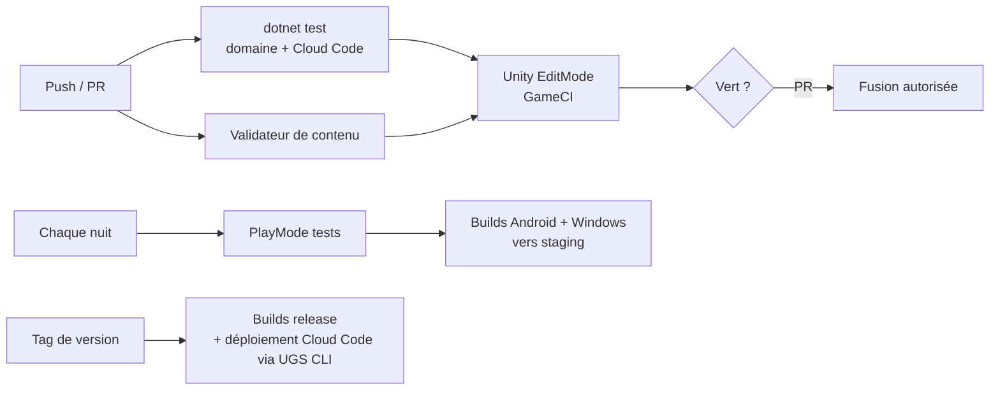

# Tests, outils et intégration continue

## Pyramide de tests
| Niveau | Outil | Portée | Quand |
|---|---|---|---|
| **Unitaires du domaine** | NUnit, lancés par `dotnet test` (hors Unity, < 10 s) et dans l'éditeur | Règles : dé, accessibilité, brouillard, dégâts, statuts, combos, IA, économie, timers | À chaque sauvegarde en local, à chaque push |
| **Rejeu (golden tests)** | NUnit | Journaux de combat et de zone enregistrés → empreinte attendue | À chaque push ; un rejeu cassé = changement de règles à assumer (nouvelle `RulesVersion`) |
| **Application** | NUnit + ports factices | Use cases : succès, refus serveur, réseau coupé | À chaque push |
| **Cloud Code** | xUnit/NUnit sur le module | Points d'entrée, idempotence, migrations de sauvegarde | À chaque push touchant `Server/` |
| **PlayMode** | Unity Test Framework | Flux de jeu : prologue, ouvrir une zone, combat auto, retour au hub | Nightly |
| **Contenu** | Validateur | Références, localisation, pools, objectifs atteignables | À chaque push touchant le contenu |
| **Manuels** | Matrice d'appareils | Performance, lisibilité, sensations | Fin de chaque jalon |

Objectif de couverture : **≥ 80 %** sur `Domain.*`, pas d'objectif chiffré sur la présentation.

### Développement piloté par les tests (domaine)
Toute règle du domaine s'écrit **test d'abord** : le test cite la règle de la spec, échoue, puis la règle est implémentée. Exemple :
```csharp
[Test] // GDD §5 — arrêt forcé sur une case Combat
public void Move_StopsOnCombatCase_AndStoresRemainingPm()
{
    var run = ZoneRunBuilder.Line("start", "res", "combat", "res2").At("start").Build();
    var result = MovementRules.Move(run, pm: 4, target: "res2");
    Assert.That(result.StoppedAt, Is.EqualTo(new CaseId("combat")));
    Assert.That(result.RemainingPm, Is.EqualTo(2));
}
```

## Outils éditeur
| Outil | Rôle |
|---|---|
| **Éditeur de plateau** | Fenêtre dédiée : placer les nœuds, tracer les liens, assigner types/pools/cases fixes/objectifs ; aperçu du brouillard et des destinations ; validation (pas d'impasse, ≥ 3 embranchements) |
| **Validateur de contenu** | Menu + CI : contrôle de toutes les définitions |
| **Export de contenu** | Génère `content_v{n}.json` + `RulesVersion` pour Cloud Code |
| **Lecteur de journaux** | Ouvre un journal de combat/zone (envoyé par un joueur ou un test) et le rejoue pas à pas dans l'éditeur |
| **Panneau de debug** (builds de dev) | Ajouter des monnaies (serveur de dev uniquement), forcer un résultat de dé, sauter les timers, afficher les ticks ATB |

## Outils hors Unity
| Outil | Rôle |
|---|---|
| **BalanceSimulator** (console .NET) | Rejoue des milliers de combats avec le domaine partagé : taux de victoire par composition d'équipe, durée moyenne, usage des combos, puissance de chaque recrue ; export CSV |
| **BalanceImport** | Lit `05_Equilibrage.xlsx` → JSON `balance` pour Remote Config (dev, staging, prod) |

## Environnements
| Environnement | Usage |
|---|---|
| `dev` | Développement, panneau de debug actif |
| `staging` | Tests de build, soft launch interne |
| `production` | Joueurs |
Environnements UGS séparés ; le build sélectionne le sien à la compilation.

## Intégration continue (GitHub Actions)

- Les tests du domaine tournent en **moins d'une minute** : c'est la boucle de retour principale.
- Le déploiement Cloud Code et Remote Config se fait par l'**UGS CLI**, jamais à la main en production.

## Ordre de mise en place (jalon M1 — Prototype)
1. Dépôt, LFS, packages (VContainer, MessagePipe, UniTask, PrimeTween), assemblies vides et graphe de dépendances.
2. `Core` (Ids, Fixed, Pcg32, Result) + tests.
3. `Domain.Board` (dé, accessibilité, brouillard, cases) + tests.
4. `Domain.Combat` (ATB, dégâts, statuts, IA simple) + tests de rejeu.
5. Scène Board + scène Combat en greybox (vues et présentateurs minimaux), ports factices (pas encore d'UGS).
6. BalanceSimulator branché sur `Domain.Combat`.
7. Revue de fin de jalon : la boucle plateau → combat est-elle amusante ?
